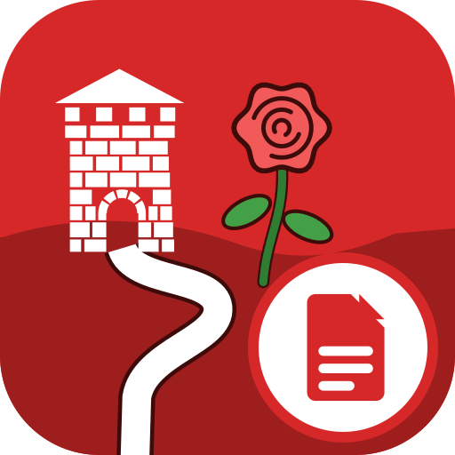

<h1 align="center">Rosenweg Dokumente</h1>

Dokumente lesen auf den Rosenweg-Smartphones – für alle in der Siedlung.

<a href="https://www.rosenweg4303.ch/apps">Herunterladen</a> · <a href="docs/anleitung.md">Anleitung</a> · <a href="docs/entwickeln.md">Für Entwickler</a>

## Was die App kann

- Öffnet PDF, DOCX, Text, Markdown, CSV und HTML.
- Dateien aus der Rosenweg-Nextcloud über Rosenweg Files oder die Android-Dateiauswahl.
- Auf geteilten Telefonen hat jede Person ihre eigenen Einstellungen.
- Hält auf dem eigenen Handy alle Rosenweg-Apps aktuell (Rosenweg Updater).

## Plattformen

Android.

## Entwickeln

Android-App (Kotlin, Gradle) auf Basis von [commons-rosenweg](https://github.com/Rosenweg/commons-rosenweg).
`./gradlew assembleFossRelease` – Bau, Signatur, Logo und Veröffentlichung stehen in
[docs/entwickeln.md](docs/entwickeln.md).

## Herkunft und Lizenz

Basiert auf [Fossify Documents](https://github.com/FossifyOrg/Documents). Herzlichen Dank an das Fossify-Team und alle Mitwirkenden für die solide Grundlage.
GPL-3.0, siehe [LICENSE](LICENSE).
